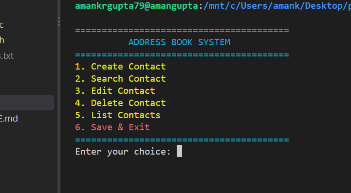
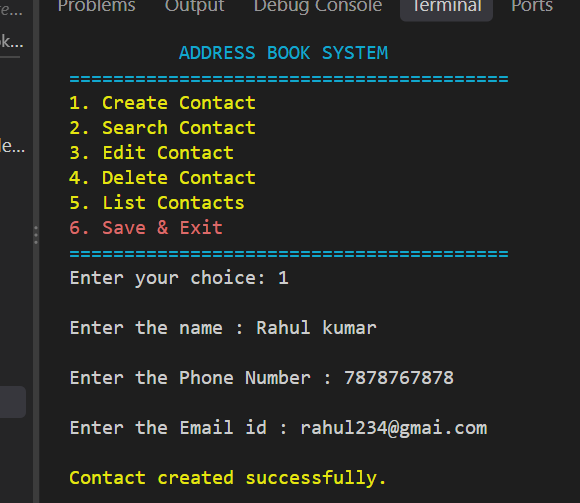
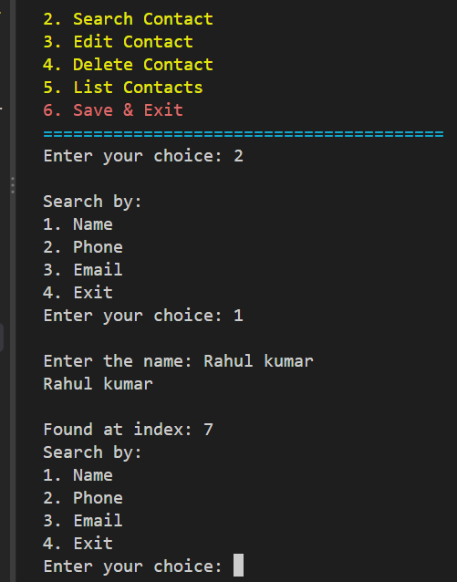
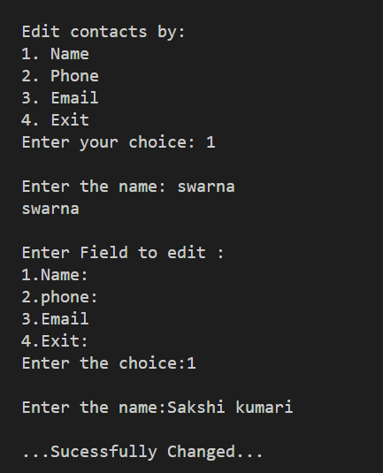
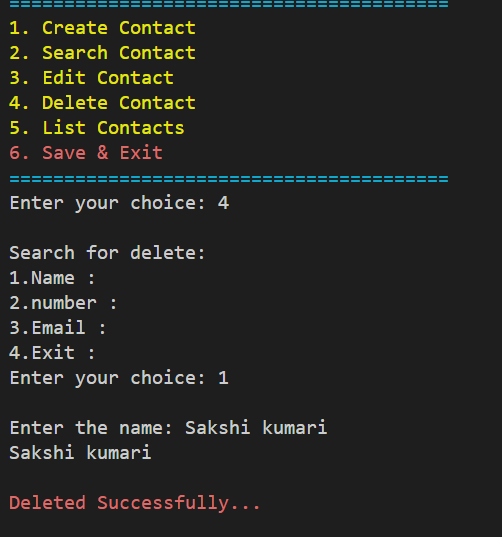
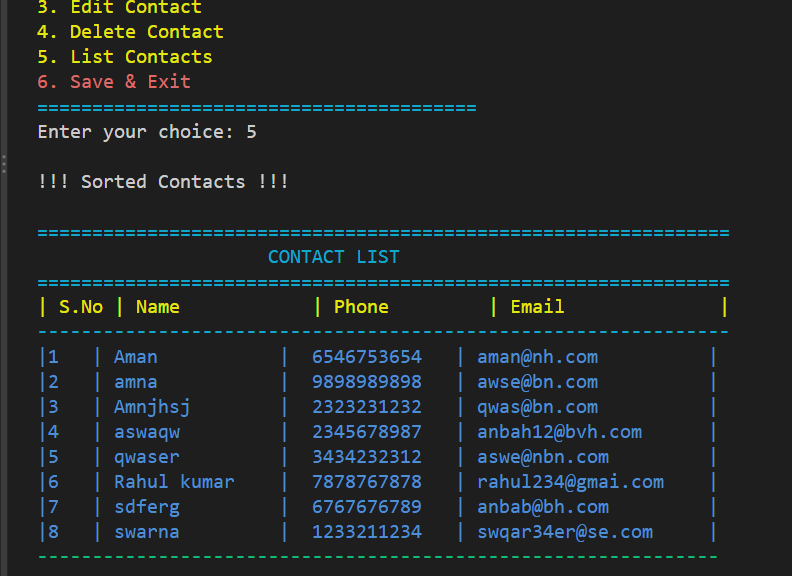

# Address Book Management System

## Description

A menu-based Address Book Management System developed using C programming.

## Features

- Create new contacts
- Search contacts by name, phone number and email
- Edit existing contacts
- Delete contacts
- Display all contacts
- Save and load contacts using file handling
- Validate user input

## Technologies Used

- C Programming
- Structures
- Pointers
- Functions
- Arrays
- File Handling
- String Handling

## 📚 Learning Outcomes

Through this project, I gained practical experience in:

- Designing a multi-file C application.
- Working with structures and pointers.
- Passing structures through functions.
- Performing CRUD operations.
- Validating user input.
- Reading and writing data using files.
- Debugging and resolving logical and compilation errors.

## How to Compile

gcc main.c contact.c file.c -o addressbook

## How to Run

./addressbook

## 📸 Project Screenshots

### 1. Main Menu

### 2. Create Contact

### 3. Search Contact

### 4. Edit Contact

### 5. Delete Contact

### 6. List Contact

## 🚀 Future Improvements

- **Dynamic Memory Allocation:** Use dynamic memory allocation to support a flexible number of contacts instead of a fixed-size array.

- **User Interface Enhancement:** Develop a graphical user interface (GUI) to make the application more interactive and user-friendly.

- **Data Export and Import:** Add support for importing and exporting contact information in CSV format.

- **Advanced Search:** Implement partial-name searching and more flexible search functionality.

- **Data Security:** Introduce password protection and secure handling of stored contact information.

## Author
Aman Kumar Gupta
